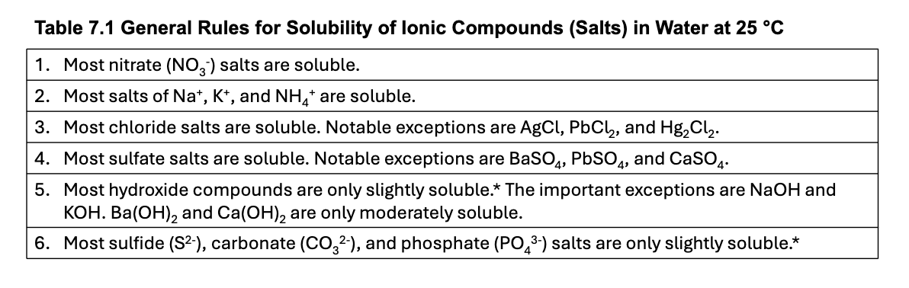
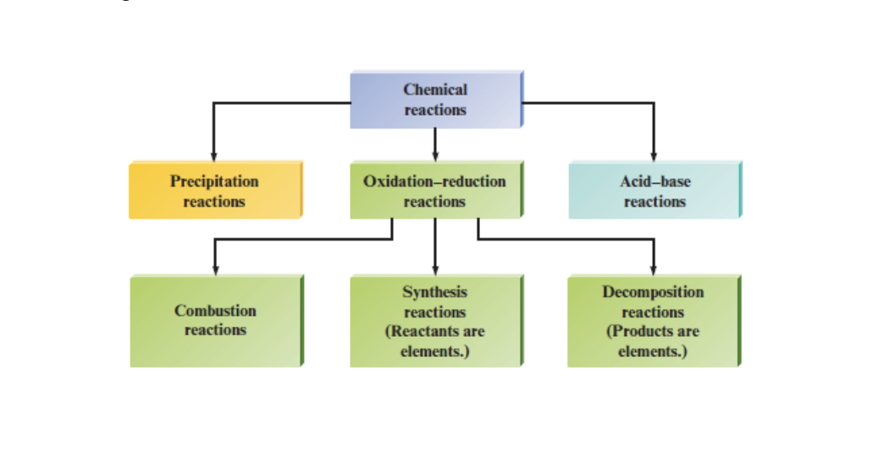

# Lecture 10-12-2026

# Types of Reactions

## Precipitation Reaction

THe formation of a solid when two solutions are mixed. The solid that forms is called the Precipitate. You can determine what forms based on the solubility rules table:

Solubility Rules

## Double Displacement Reaction

\\ \mathrm{K_2CrO_4 (aq) + Ba(NO_3)\_2 (aq) \rightarrow BaCrO_4 (s) + 2 KNO_3 (aq)} \\

In the above reaction the two anions are exchanged. The products have inverse associates compared to the reactant side.

This occurs in acid-base reactions and precipitation reactions. It does not occur in electron exchange (redox) reactions.

## Acid-Base Reaction

When a reaction involving a base and an acid occurs the formation of water and some other element is produced. Hydroxide and the extra hydrogen ion combine to create water.

## Oxidation Reduction Reaction

\\ \mathrm{2Li(s) + F_2 (g) \rightarrow 2LiF(s)} \\

In this reaction each lithium atom loses one electron to form \\\mathrm{Li^+}\\ and each Fluorine gains the electron to form \\\mathrm{F^-}\\ ion.

For example:

\\ \mathrm{Fe (s) + CuCl_2 (aq) \rightarrow Cu (s) + FeCl_2 (aq)} \\

The iron reacts with the copper (II) chloride, as a result for copper (II) to remain stable as a solid it must gain two electrons to form a balanced Cu, otherwise it remains an ion at \\\mathrm{Cu^{2+}}\\

Chlorine has two atoms in either Iron (II) chloride or copper (II) chloride. As a result, each Chlorine atom will gain one electron, and Iron will lose two electrons.

## Gas Evolution Reaction

A type of acid-base reaction in which a gas is formed in the products.

\\ \mathrm {2HCl (aq) + Na_2CO_3 (aq) \rightarrow CO_2 (g) + H_2O (l) + NaCl(aq)} \\

The reaction forms carbon dioxide out of it’s products as well as water.

## Single Replacement Reactions

\\ \mathrm{Zn (s) + 2 HCl(aq) \rightarrow H_2 (g) + ZnCl_2 (aq)} \\

This reaction is a type of oxidization-reduction reaction (redox). This reaction is also a single replacement reaction since a single type of anion was exchanged between \\\mathrm{H^+}\\ and \\\mathrm{CL^-}\\

## Combustion Reaction

MAny chemical reactions that involve oxygen produce energy (heat) so rapidly that a flame results.

Such reaction are called combustion reactions:

\\ \mathrm{CH_4 (g) + 2O_2 (g) \rightarrow CO_2 (g) + 2 H_2O (g)} \\

Techincally also a redox reaction.

## Synthesis Reactions

When a given compound is formed via simpler materials, this is called a sythesis or combination reaction:

\\ \mathrm{2Na(s) + Cl_2 (g) \rightarrow 2NaCl(s)} \\

## Decomposition Reaction

In many cases a compound can be broken down into simpler compounds or all the way to the component elements.

This is usually accomplished by heating or by application of an electric current

\\ 2H_2O (l) \rightarrow 2H_2 + O_2 \\

Classes of Reactions
