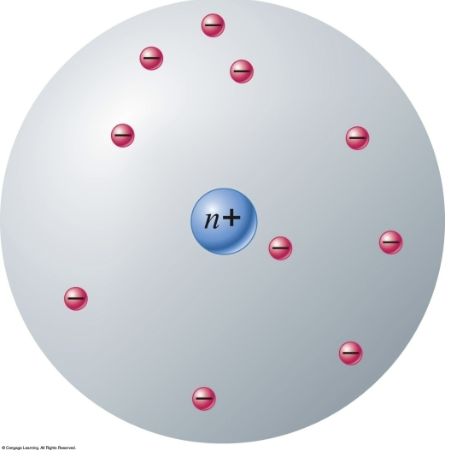
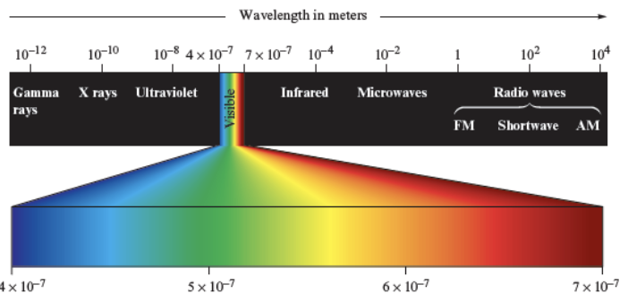
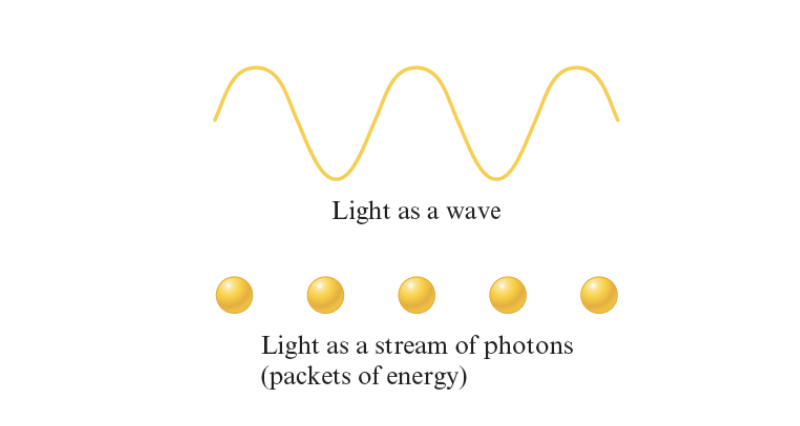
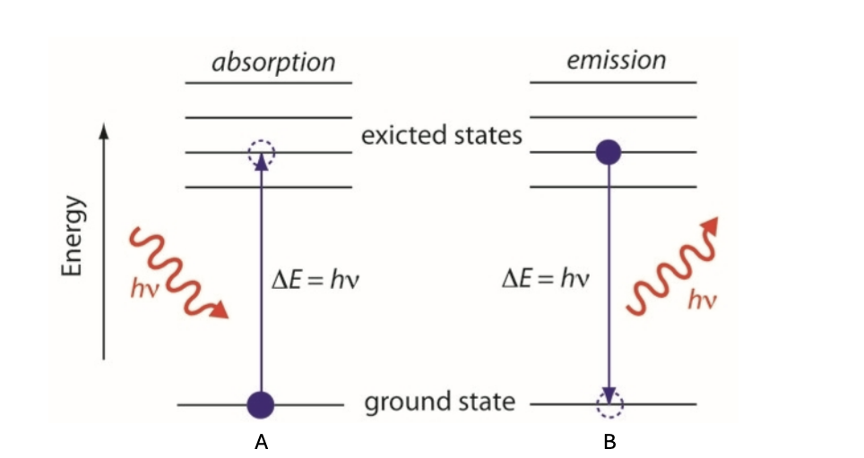
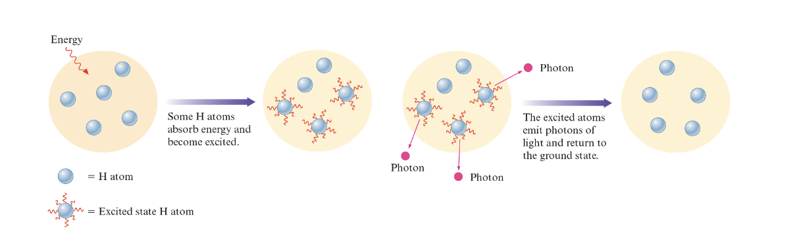
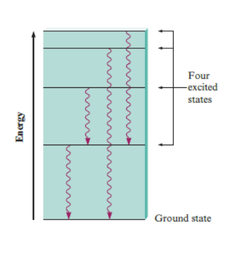
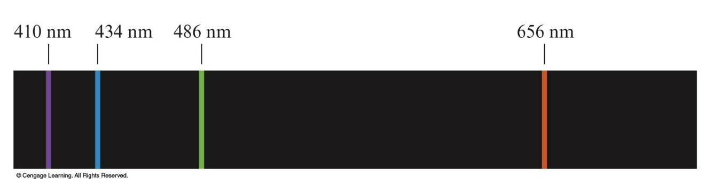
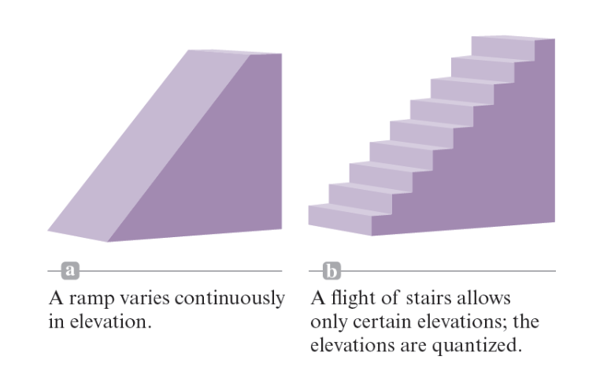
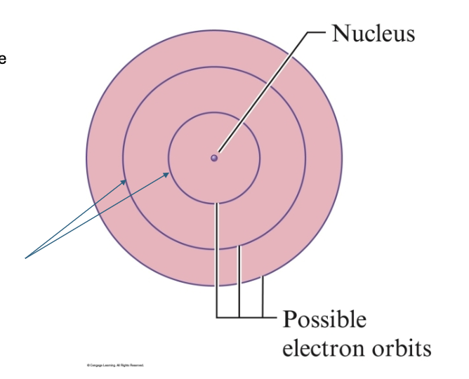

# Lecture 11-2-2026

# Final Exam Material

This course skips Chapter 10.

# Chapter 11 - Modern Atomic Theory

The atom has a small dense nucleus - It is positively charged - It contains protons, which have a +1 charge. - It contains neutrons which have no charge.

The remainder of the atom is mostly empty space. - What is does contain is electrons, each of which have a -1 charge.

An example of particles in an atom

In a stable atom, electrons and the sum of their charge equals the charge of the nucleus providing a stable 0 charge for the atom overall.

## Electromagnetic Radiation

Figure depicting the spectrum of light wavelengths

Light is also referred to a electromagnetic radiation.

A light travels in waves, a particular wave is characterized by three properties: - wavelength - frequency - speed

Longer wave lengths tend to have a lower (speed and therefore frequency).

The wavelength measures the distance in linear space for one wave. Frequency is the occurance of one wave (how many peaks occur) in a section of time (typically one second). And speed is therefore how quickly distance is traveled during the experience of the wavelength over time.

The speed of electromagnetic radiation is the speed of light. So for each of the different measured wavelengths on the above figure it’s relative speed is the speed of light.

So Gamma rays would be extremly high energy and radio waves would be quite low energy in comparison.

------------------------------------------------------------------------

## Wavelength and Frequency

Wavelength is symbolized by $\lambda$, it’s the distance between two consecutive wave peaks.

Frequency is measured by $\nu$ indicated how many wave peaks pass a certain point per a given time period.

Frequency tends to measured in Hz.

Speed is the speed of light (c) and $C = \lambda \nu$

## Dual Nature of Light

Methods of depicting light

Waves can be pictured as either a wave or a stream of individual packets called photons.

## How Photons Interact With Electrons

Electrons and Photons Interaction depicted

Consider the horizontal lines as levels of electron shells in an atom. Each time the atom changes levels in that shell it emits some energy change represented by photons being absorbed or emitted.

## Emission of Photons by an Excited Hydrogen Atom

Photon interaction in an hydrogen atom

Atomic States - An atom with an excess energy is said to be excited. - An atom with the lowest possible energy is said to be in it’s ground state.

When an H atom absorbs energy from an outside source (from heat or electricity) it enters an excited state.

## Energy Levels

Energy Levels Example

1.  Only certain types of photons are produced by an atom in an excited state.
2.  This means an atom must have certain discrete energy levels.
3.  We say the energy levels of the atom are quantized energy levels, meaning only certain values are allowed.

Hydrogen emits these colors

So that is to say that energy levels have a fixed amount of energy per level. Therefore to transition from one level to another a fixed amount of energy is given off:

Quantized Energy Levels

------------------------------------------------------------------------

Bohr Model

According to the Bohr Model electrons are allowed to only exist in the areas that are purple. They are not allowed in the pink areas.

This would explain why hydrogen emission pattern where each color of light corresponds to the distance from one orbit to the next.

## The Wave Mechanical Model of the Atom

In the mid-1920’s the Bohr model was proven incorrect.

Louis Victor de Broglie and another guy suggested that because light seems to have both wave and particle characteristics, the electron might also exhibit both of these characteristics. This is called the wave mechanical model of the atom.

## Hydrogen Orbitals

The probability map for the hydrogen electron is called an orbital.

Althought the probability of finding an electron decreases at greater distances from the nucleus, the probability of finding it at greater distances from the nucleus never becomes exactly zero.

Chemists therefore define the the size as the sphere that contains 90% of the total electron probability.
