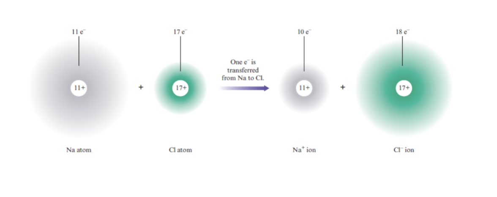

# Chapter 7 Cont. 

## Transferring Electrons 

When a sodium atom reacts with a chlorine atom an electron is transferred. 

---

## Electron Transfer in Reactions 

- A reaction that involves a transfer of electrons is called an oxidation-reduction reaction. 

*"LEO the lion says GER"*

Loss of electrons is oxidization (LEO)

Gaining of electrons is reduction (GER)

--- 

A Redox reaction is a reduction-oxidization reaction. 

$$
\mathrm{2Al + N_2 \rightarrow 2AlN}
$$

Ergo based on the ions these form you can find where electrons have been gained/transferred and figure out who is being oxidized and who is being reduced. 

