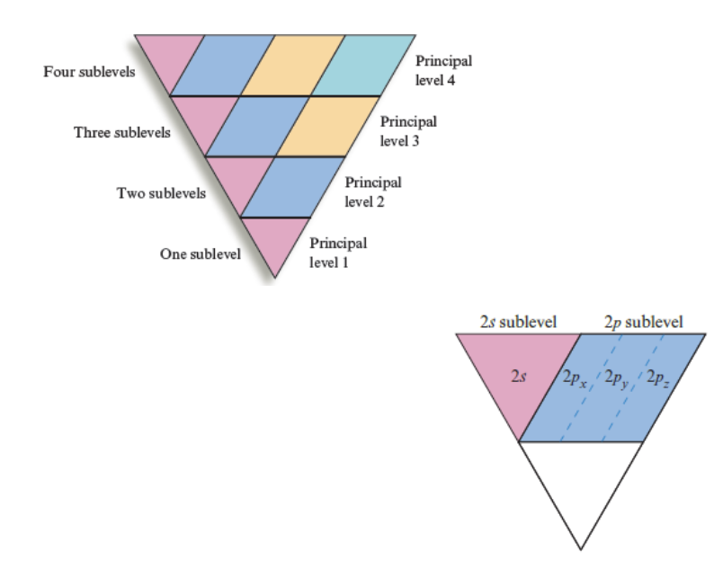
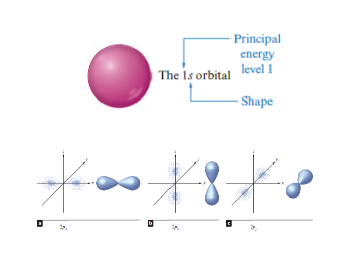
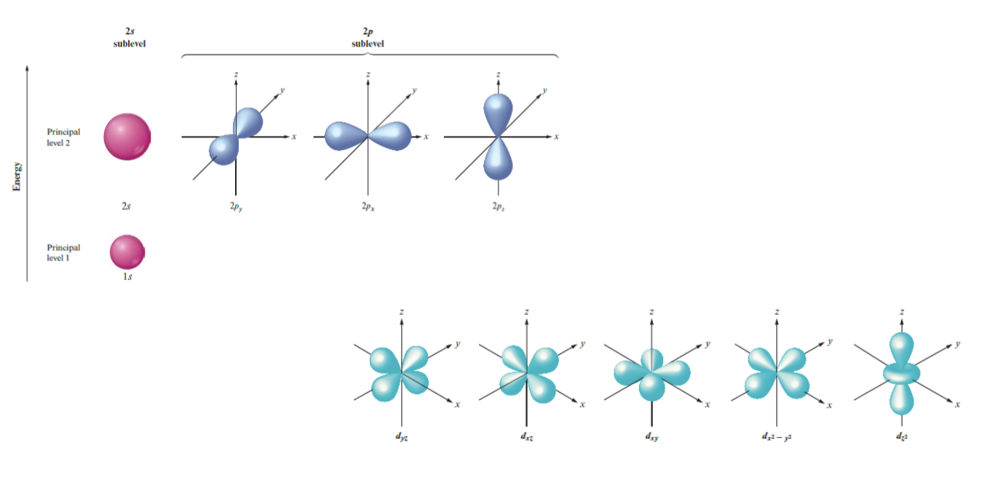
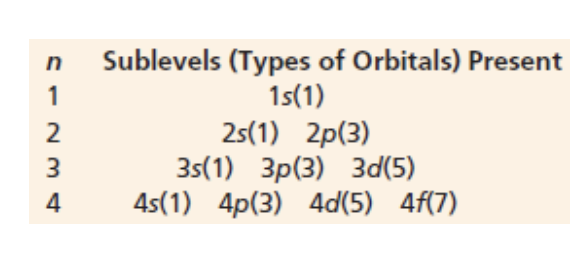
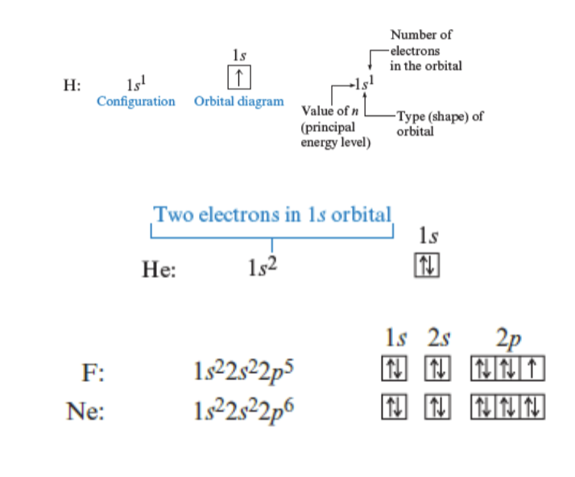
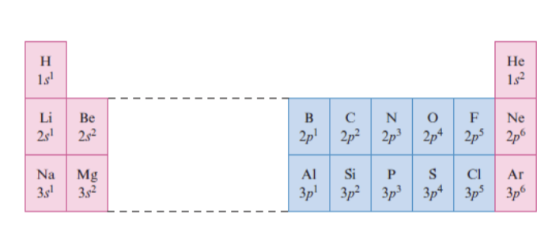
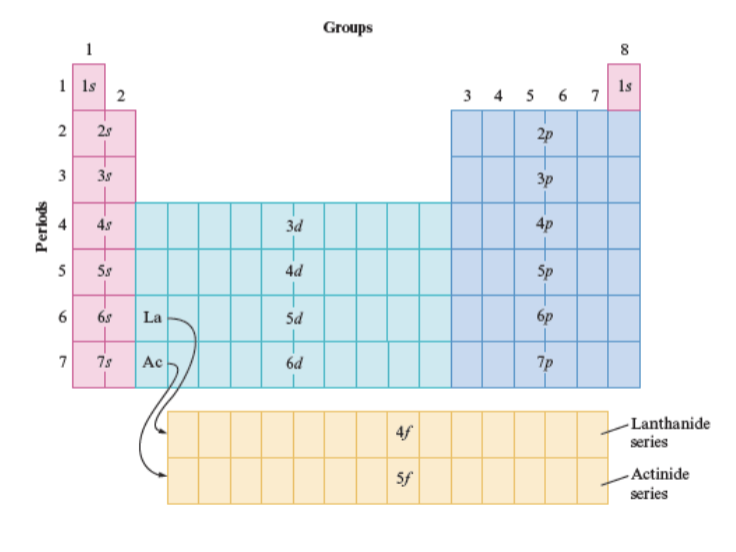
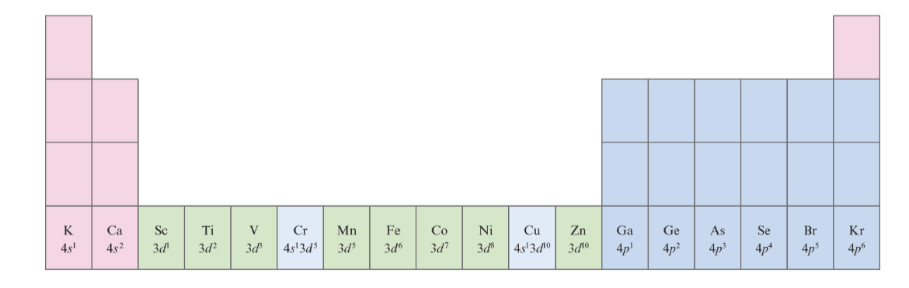

# Chapter 11 Cont.

## Levels and Sublevels

Bohr's model works well for the hydrogen atom because electrons only tend to move through principal levels.

Each principal level introduces a new set of orbitals.

An orbital is a shape in which an electron can be found not necessarily the path an electron takes around an atom.

Subelevels are called orbital types.

Each orbital holds a max of two electrons.

The hourglass shape represents the probability cloud, or the likely area where an electron is going to be found.

## Spin

Consider electrons spinning as a top spins on its axis.

Like the top, an electron can only spin either clockwise or counterclockwise. In order for two electrons to occupy the same shell they must spin in opposite directions.

This is what the Pauli exclusion principal defines: An atomic orbital can hold a max of two electrons, and those two electrons must have opposite spins.

The opposite spins create an attractive force between the two electrons.

## Principal Components of the Wave Mechanical Model of the Atom

Atoms have a series of energy levels called principal energy levels. These are whole numbers symbolized by n, n can equal 1,2,3,4, Level one corresponds to n=1 and so on.

Based on the principal level of the atom, that determines what orbitals are present.

## Electron Arrangement

The most attractive orbital to an electron in any atom is always the 1s because this orbital is the closest to the positively charged nucleus.

As n increases the orbital becomes larger and the electron therefore is present in space further from the nucleus creating a less attractive force between the positively charged nucleus and the negatively charged electron.

Electrons will fill the principal levels of the electrons by first filling each orbital alone, once each orbital has at least one electron a second electron can then fill that level.

## Valence Electrons 

These are electrons in the outermost shell (highest principal energy level) of an atom.

The inner electrons which are known as core electrons are not involved in bonding atoms to each other.

Atomic elements int he same group have the same number of electrons in a given type of orbital.

Elements with the same valence electron arrangement show similar chemical behavior. 

---

And some elements only have a partial configuration

